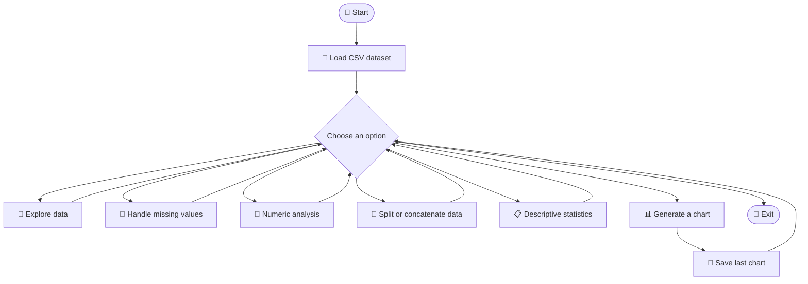
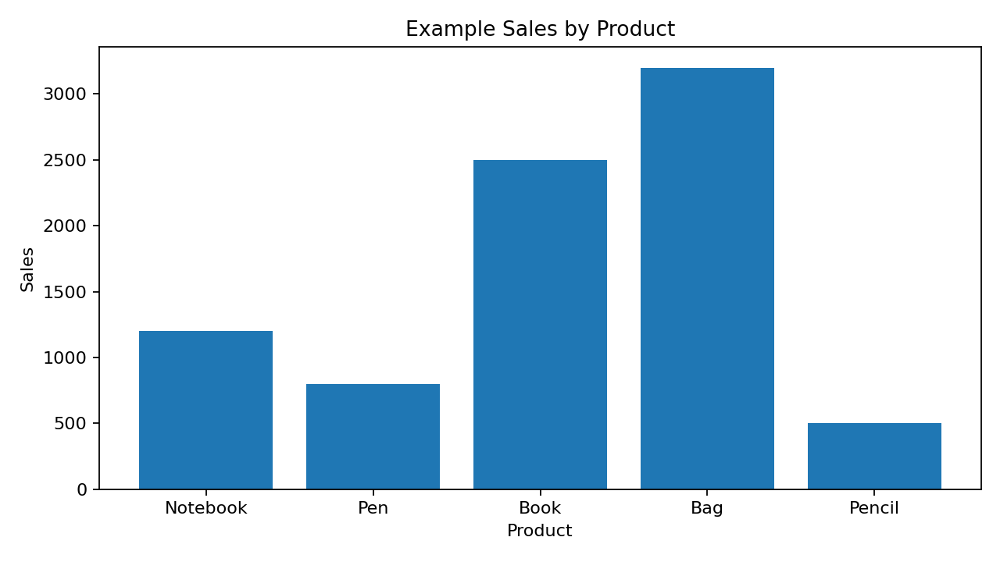
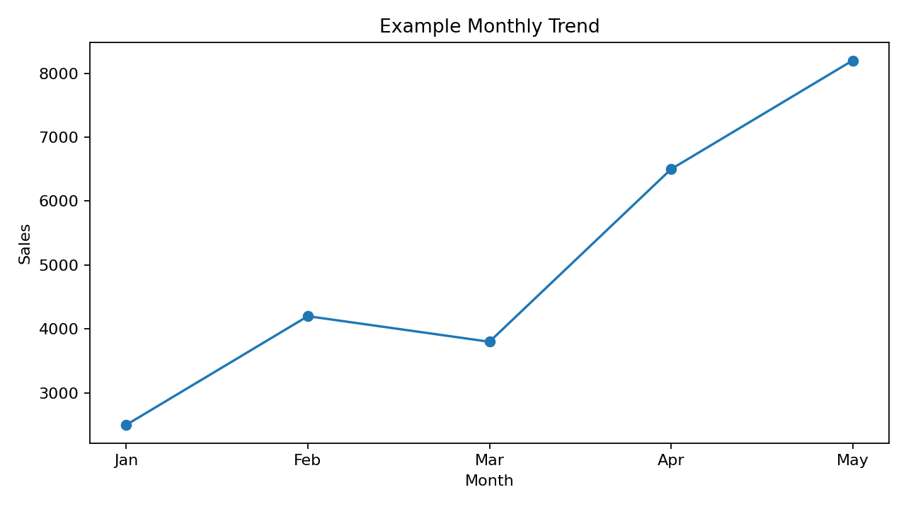
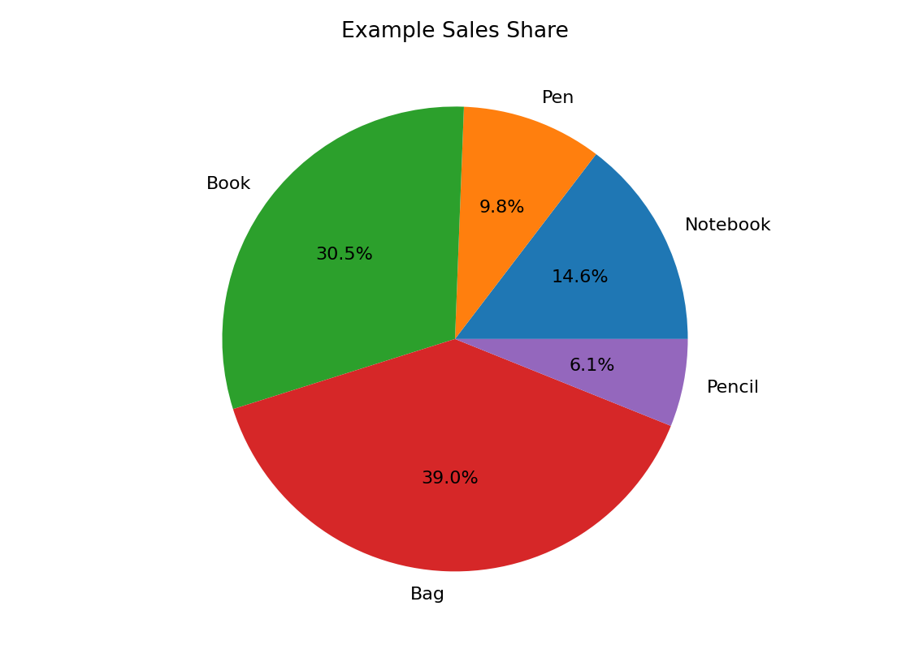
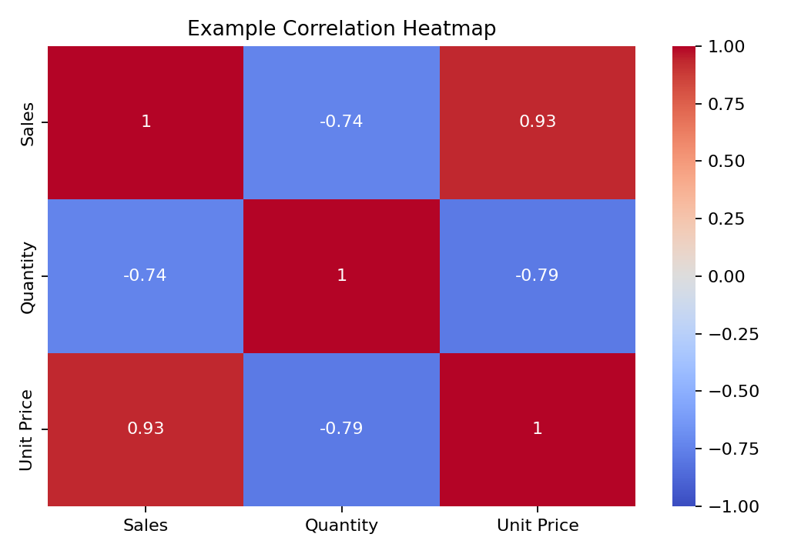
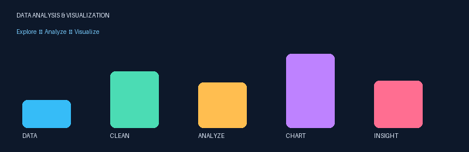

::: {align="center"}
<div align="center">


</div>
# 📊 Data Analysis & Visualization Program

**A menu-driven Python project to load CSV datasets, explore data,
handle missing values, calculate statistics, and create
visualizations.**

<p>
<p align="center">
  
  
  
  
  
</p>

</p>
```
:::

------------------------------------------------------------------------

## ✨ Overview

This project is a beginner-friendly, command-line **Data Analysis &
Visualization Program** written in Python. It lets users load a CSV file
and perform common data-analysis tasks through a simple menu.

Use it to inspect datasets, identify missing values, calculate numeric
summaries, combine or split rows, and visualize patterns with charts.

> **Project note:** Although the class is named `StudentSalesAnalyze`,
> the program can analyze different CSV datasets. Some chart options
> depend on specific column positions, so use a dataset with suitable
> columns or customize the chart code for your data.

## 🚀 Features

  -----------------------------------------------------------------------
  Feature                             What it does
  ----------------------------------- -----------------------------------
  📂 Load dataset                     Reads a CSV file into a Pandas
                                      DataFrame

  🔎 Explore data                     Shows first/last rows, column
                                      names, data types, and DataFrame
                                      info

  🧹 Handle missing data              Displays rows with missing values,
                                      fills numeric missing values with
                                      column means, drops incomplete
                                      rows, or replaces missing values

  🔢 Numeric analysis                 Calculates sum, average, maximum,
                                      and minimum for a numeric column
                                      using NumPy

  🔗 DataFrame operations             Concatenates a second CSV below the
                                      current data or previews the two
                                      halves of a dataset

  📈 Descriptive statistics           Displays `describe()`, standard
                                      deviation, and variance

  📊 Visualizations                   Creates bar, line, scatter, pie,
                                      correlation heatmap, histogram, and
                                      stack plots

  💾 Save chart                       Saves the most recently created
                                      chart to an image file
  -----------------------------------------------------------------------

## 🧭 How it works



The diagram is rendered by GitHub's Mermaid support. It is a workflow
diagram, not an animated process simulation.

## 📸 Chart gallery

The images below are **illustrative previews made with sample values**,
not output from your personal CSV file. Run the program on your dataset
to create real charts.

### 📊 Bar chart --- compare categories



### 📈 Line chart --- view a trend



### 🍰 Pie chart --- compare category shares



### 🔥 Correlation heatmap --- inspect numeric relationships



### 🖼️ Animated graphic



The animated graphic is a decorative GIF for the README. The Python
program itself creates charts using Matplotlib and Seaborn when you
choose the visualization menu.

## 🧰 Built with

-   **Python** --- application logic and menu system
-   **Pandas** --- CSV loading, DataFrame operations, and data summaries
-   **NumPy** --- numeric array calculations
-   **Matplotlib** --- bar, line, scatter, pie, histogram, and stack
    plots
-   **Seaborn** --- correlation heatmap styling
-   **Mermaid** --- GitHub-rendered workflow diagram

## 📁 Suggested project structure

Keep the Python script, README, and assets in the same repository:

``` text
data-analysis-visualization/
├── main.py
├── README.md
└── assets/
    ├── bar_chart.png
    ├── line_chart.png
    ├── pie_chart.png
    ├── heatmap.png
    └── data_animation.gif
```

If your Python file has a different name, replace `main.py` in the run
command below with your actual filename.

## ⚙️ Installation and setup

### 1. Install Python

Install Python from [python.org](https://www.python.org/downloads/).
Python 3.10 or later is a sensible choice.

### 2. Download or clone the repository

``` bash
git clone https://github.com/YOUR-USERNAME/YOUR-REPOSITORY.git
cd YOUR-REPOSITORY
```

Replace the example repository URL with your own GitHub repository URL.
Or download the repository as a ZIP and open its folder in VS Code.

### 3. Install dependencies

Open a terminal in the project folder and run:

``` bash
python -m pip install pandas numpy matplotlib seaborn
```

### 4. Run the program

``` bash
python main.py
```

On some Windows setups, use:

``` bash
py main.py
```

### 5. Load a CSV file

Choose **1. Load Dataset** and enter the CSV path when prompted.

Examples:

-   CSV file in the current folder: `sample.csv`
-   Windows absolute path: `C:\Users\YourName\Downloads\sample.csv`
-   macOS/Linux path: `/home/yourname/data/sample.csv`

Use the actual path on your computer. File paths containing spaces
should work when entered as a normal response to the prompt.

## 🧪 Example dataset

For a quick test, create a file called `sample.csv` with this content:

``` csv
Product,Region,Category,Sales,Quantity
Notebook,North,Stationery,1200,10
Pen,South,Stationery,800,20
Book,East,Education,2500,15
Bag,West,Accessories,3200,8
Pencil,North,Stationery,500,25
```

This sample includes numeric `Sales` and `Quantity` columns and category
columns. It is suitable for exploring the menu, numeric analysis, and
several visualizations. **Your current chart code uses positional
columns in several options**; see the compatibility notes below before
relying on every chart with a different dataset.

## 🖥️ Main menu

When the script runs, it displays a menu similar to this:

``` text
========== Data Analysis & Visualization Program ==========
Please select an option:
1. Load Dataset
2. Explore Data
3. Perform DataFrame Operations
4. Handle Missing Data
5. Generate Descriptive Statistics
6. Data Visualization
7. Save Visualization
8. Exit
===========================================================
Enter your choice:
```

### Menu guide

  Option   Action
  -------- ---------------------------------------------------
  `1`      Load a CSV dataset
  `2`      Explore rows, columns, data types, and basic info
  `3`      Concatenate another CSV or preview a split
  `4`      View or handle missing values
  `5`      Display descriptive statistics
  `6`      Open the chart menu
  `7`      Save the last chart
  `8`      Exit

### Chart menu

  -----------------------------------------------------------------------
  Choice                  Chart                   Current code behavior
  ----------------------- ----------------------- -----------------------
  `1`                     Column bar chart        Uses the second column
                                                  for labels and fourth
                                                  column for values

  `2`                     Trend line              Plots values from the
                                                  fourth column by row
                                                  index

  `3`                     Scatter diagram         Uses the X and Y
                                                  columns entered by the
                                                  user

  `4`                     Sales distribution pie  Groups the third column
                          chart                   and sums the fourth
                                                  column

  `5`                     Correlation heatmap     Uses all numeric
                                                  columns

  `6`                     Histogram               Displays the
                                                  distribution of the
                                                  fourth column

  `7`                     Stack plot              Plots the fourth column
                                                  against the row index

  `8`                     Back                    Returns to the main
                                                  menu
  -----------------------------------------------------------------------

## ⚠️ Data and chart compatibility notes

To make the project work reliably, keep these points in mind:

1.  **Column positions matter in the current chart code.** Bar, line,
    pie, histogram, and stack plots refer to `self.df.iloc[:, ...]` or
    `self.df.columns[...]`. They may show the wrong information or fail
    if your CSV has fewer than four columns or a different column order.
2.  **Use numeric data for numeric operations.** NumPy calculations need
    a numeric column. The heatmap uses numeric columns only.
3.  **Mean filling affects numeric columns only.**
    `fillna(self.df.mean(numeric_only=True))` does not fill missing
    text/category values.
4.  **The "merge" option concatenates rows.** It uses `pd.concat`, so it
    stacks the second dataset under the first rather than joining
    records by a shared key.
5.  **The split option previews halves.** It prints previews of the two
    halves; it does not save separate CSV files.
6.  **The chart save option saves the last chart.** Enter a filename
    such as `sales_chart.png`. Use a suitable image extension like
    `.png` or `.jpg`.
7.  **Correlation needs enough numeric information.** If the dataset has
    no numeric columns, a meaningful heatmap cannot be produced.

## 🧠 Concepts demonstrated

-   Python classes and methods
-   `if` / `elif` conditions and `while` loops
-   Exception handling with `try` / `except`
-   CSV file loading using Pandas
-   DataFrame filtering, slicing, grouping, and concatenation
-   Missing-value handling
-   NumPy array calculations
-   Descriptive statistics
-   Data visualization and chart saving

## 🛣️ Future improvements

-   [ ] Select columns by name instead of fixed column positions
-   [ ] Add input validation for chart columns
-   [ ] Export cleaned datasets to CSV
-   [ ] Save split datasets as separate files
-   [ ] Add true key-based DataFrame merge/join
-   [ ] Add a GUI dashboard with Streamlit or Tkinter
-   [ ] Add unit tests and sample datasets
-   [ ] Add more interactive Plotly charts

## 👨‍💻 Author

**Project:** Data Analysis & Visualization Program\
**Language:** Python\
**Purpose:** Practice data handling, numerical analysis, and data
visualization.

## ⭐ Show your support

If this project helped you learn Python or data visualization, give the
repository a ⭐ on GitHub.

::: {align="center"}
**Explore data. Find patterns. Tell the story with charts.** 📊
:::

KRISH-DAHIYA
